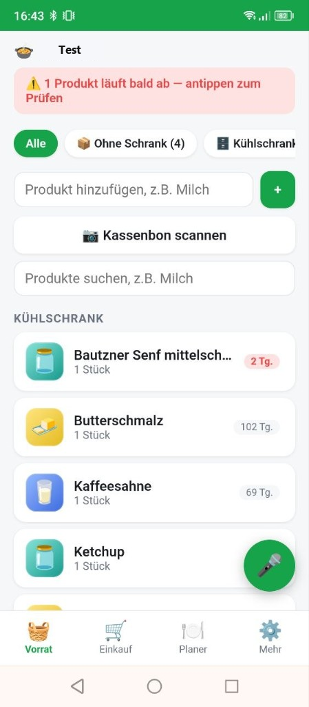
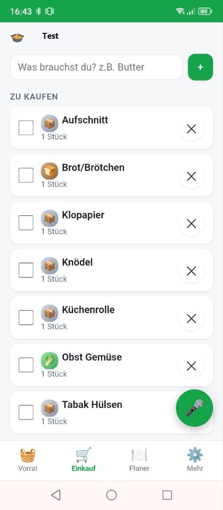
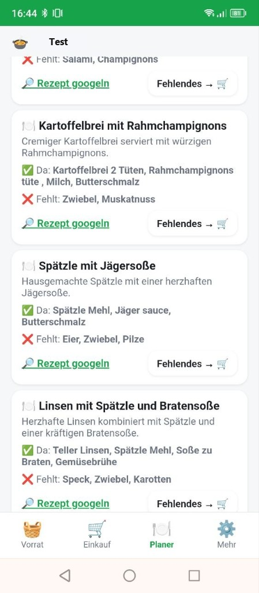
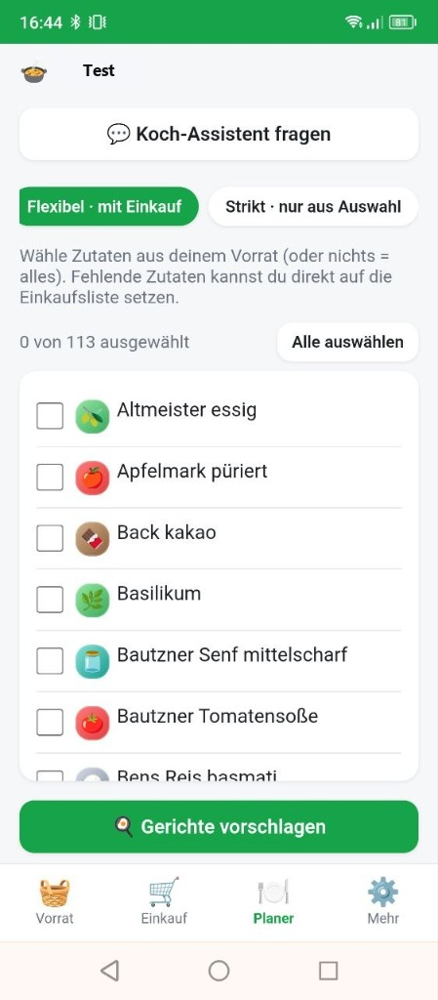
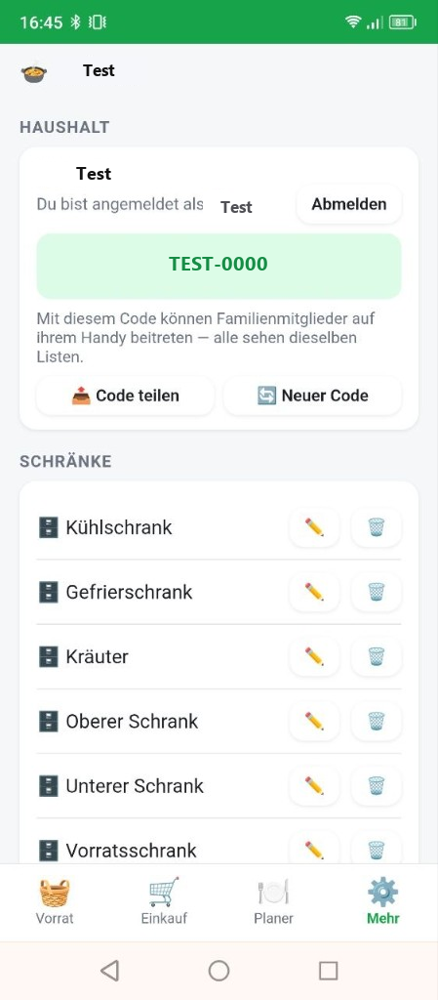
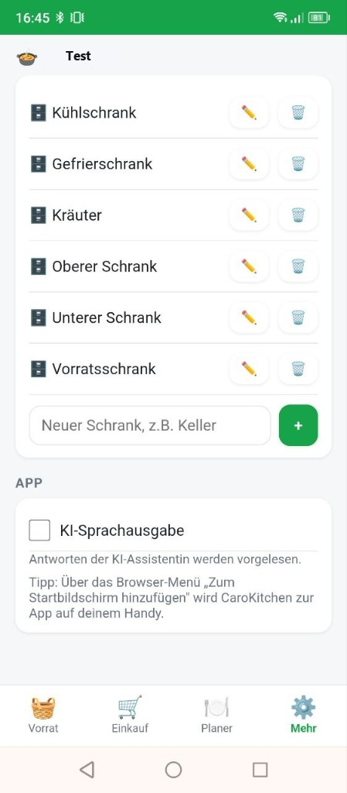

# CaroKitchen

Familien-Vorrats-App — PWA und Android. Bald im **Google Play Store**.

## Was das ist

CaroKitchen hilft Haushalten, Vorräte, Einkauf und einfache KI-Unterstützung
unter einem Dach zu halten: Produkte erfassen, Haushalt teilen, per Sprache
bedienen, Listen synchron halten sowie einfach ein Foto des Kassenbons machen
und die KI übernimmt das Ganze als eine Liste.

Aktuell: stabile App-Version in Vorbereitung für den Store-Release.
Quellcode bleibt vor dem Launch privat.

## Status

- [x] Produkt & Kernfunktionen ausgearbeitet  
- [x] Android-Variante (Kotlin / Jetpack Compose)  
- [x] Web/PWA-Variante (React, Cloudflare)  
- [ ] Veröffentlichung im **Google Play Store** (in Arbeit)  

## Stack (Überblick)

| Teil | Technik |
|------|---------|
| Android | Kotlin, Jetpack Compose |
| PWA | React, Vite, Cloudflare Workers / D1 |
| KI | serverseitig (Keys nie im Client) |

## ansicht

## Kontakt / Portfolio

Mehr Projekte: [github.com/Cahja90](https://github.com/Cahja90)

---

*Showcase-Repo — ohne Quellcode bis zum Store-Launch.*
